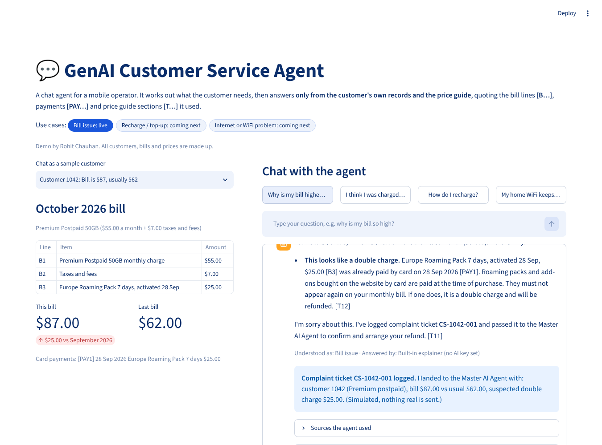

# GenAI Customer Service Agent

A chat agent for a mobile operator. It works out what the customer needs (bill issue, recharge, internet/WiFi), then answers only from the customer's records and the price guide, quoting the bill lines [B...], payments [PAY...] and tariff sections [T...] it used. Bill issues are live; recharge and internet/WiFi are next. All data is made up.

## How it works
1. A keyword router picks the use case.
2. For a bill issue, `agent.py` compares this bill with last month's and with card payments in plain Python (exact numbers, double-charge check).
3. It retrieves the matching price guide sections (RAG, BM25 keyword search).
4. A free LLM (Groq Llama 3.3 70B, or Gemini Flash) writes the answer from those sources only. With no key, a built-in explainer answers instead.
5. A double charge logs a complaint ticket and hands it to the Master AI Agent (simulated).

## Files
- `app.py`: the web page (Streamlit)
- `agent.py`: the agent logic
- `data/bills.json`, `data/tariff.json`: made-up bills and price guide (edit these to change the demo)

## Run it on your PC
    pip install -r requirements.txt
    streamlit run app.py

## Free AI key
Put the key in Streamlit Cloud > App settings > Secrets as `GROQ_API_KEY = "..."` (or `GEMINI_API_KEY`). Never put keys in the code.

